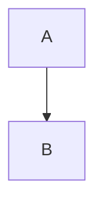

<!-- docspec: information-model/1.12 -->
<!-- readable: headings=divs; of=demo.tomspecs.yaml; commit=0000000 -->
# <!--[DEMO]-->  Every construct

::: {.editorial}
**The provenance notes.** The notes below name their sources; this preamble is for authors.
:::

## <!--[TEXT]-->  Text

A paragraph with *emphasis*, **strong**, `code with | pipe`, an escaped \* star, characters Typst reads — # $ @ < > ~ / = - + . : " ' — and a
wrapped second line. Links: [within](#TABLES), [the document's rendition](demo.tomspecs.md#TEXT), [another document](other.tomspecs.md#X), <https://typst.app>.
A hard break follows  
here, and a statement backed by ids (-> C2.1, FR-12), taken from a file (<- notes.md#X) and extrapolated (<~ iterations/sbpa21_notes.md), with [an aside]{.aside} inline and [an unknown span]{.custom}.

(<~ iterations/sbpa10_notes.md)

- a bullet
  wrapped
  - a nested bullet
- second bullet

3. third
4. fourth

> **❓ DQ-1 — a question:** kept as text, with a mark {++added++}{@agent 2026-11-21T13:00+01:00}.
>
> **Answer:**

---

## <!--[TABLES]-->  Tables

| TomSpecField | Value |
| --- | --- |
| Status | approved |
| Description | A value that is long enough to wrap in its cell, well over one line of the column it stands in. |

::: {.records}
| Id | Given | When | Then |
| :-- | --- | :-: | --: |
| ACE-1 | A tenant administrator with a very long description of the situation | The administrator acts | The result is recorded and audited |
:::

| Section | TomSpecField | Value |
| --- | --- | --- |
| RT-TRAC | RelatedGoals | [TEXT](#TEXT) |

::: {.refs}
[DEMO](#DEMO), [TEXT](#TEXT), [ACE-1](#ACE-1)
:::

<!--[DEEP-1]-->  A heading of depth seven

::: {.provenance source="notes.md"}
A longer provenance block, with a nested [trace span]{.trace}.

::: {.aside}
An aside inside it.
:::
:::

::: {.unknown-kind}
Content of a kind the export does not know.
:::
