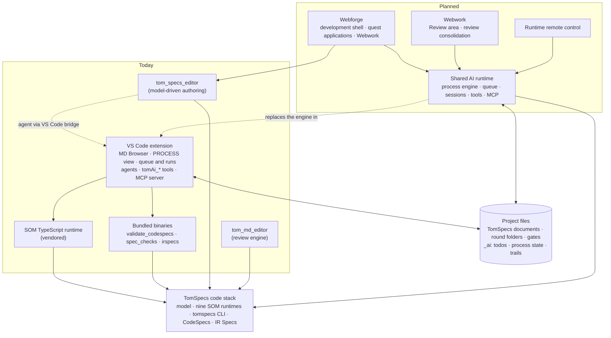
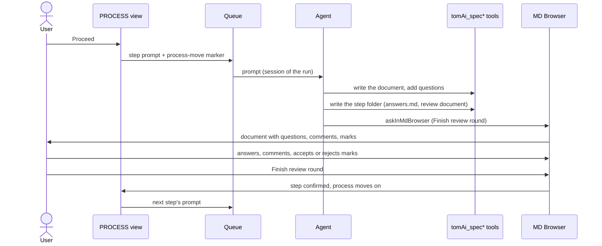
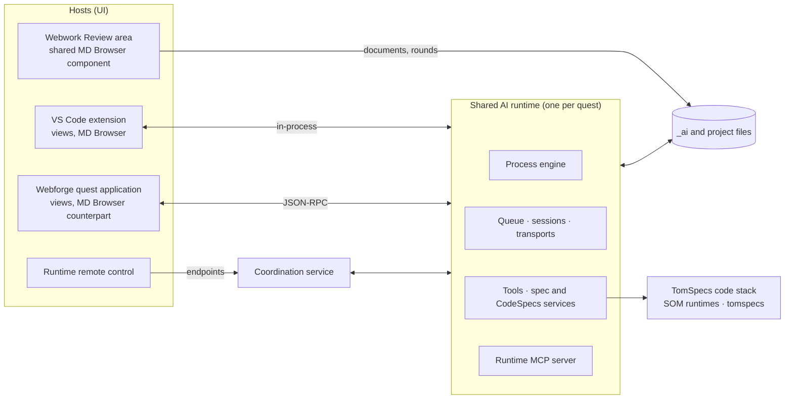
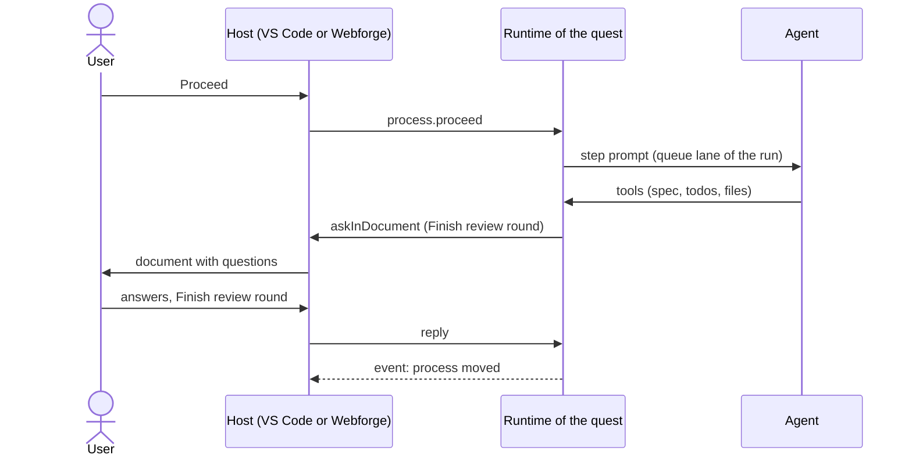
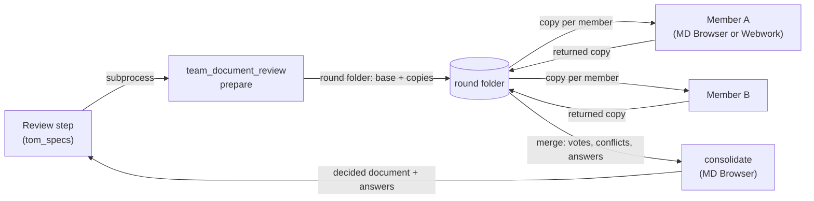

# TomSpecs Tooling

**Authority for:** the tools TomSpecs is worked with, today and as planned, and
their architecture:

- which component carries which part of the process;
- how the components reach the TomSpecs code stack and each other;
- which tool serves each phase and activity;
- the files they share;
- the move from the VS Code extension to Webforge, Webwork and the shared AI
  runtime.

What the process *is* — phases, gates, iteration rules, roles — is
`tom_specs_project_flow.md`. The model and its runtimes are
`tom_specs_model_rules.md` and `som_multiplatform_spec_model.md` (cited `SOM §N`
below). The spec-authoring app's own design is
`tom_specs_editor_specification.md`. This document does not restate them; it
places them.

## Contents

1. [Purpose and audience](#1-purpose-and-audience)
2. [The tool landscape at a glance](#2-the-tool-landscape-at-a-glance)
3. [Today's setup: the VS Code extension carries the process](#3-todays-setup-the-vs-code-extension-carries-the-process)
4. [The TomSpecs code stack under every tool](#4-the-tomspecs-code-stack-under-every-tool)
5. [The processes the tools run](#5-the-processes-the-tools-run)
6. [The target setup](#6-the-target-setup)
7. [Per phase and activity: which tool, today and planned](#7-per-phase-and-activity-which-tool-today-and-planned)
8. [Data and files every tool shares](#8-data-and-files-every-tool-shares)
9. [The move from the VS Code extension](#9-the-move-from-the-vs-code-extension)
10. [What stays in VS Code](#10-what-stays-in-vs-code)
11. [Open questions](#11-open-questions)

## 1. Purpose and audience

A TomSpecs project is worked through with tools, not on paper. The
specification is a typed object model; review happens inside the documents;
a process engine moves the project through its steps and gates; agents do most
of the writing. This document says which tool does what, how the tools fit
together, and where the tooling is going.

It is written for:

- **the product owner**, who decides where the tooling goes;
- **the agents** working a TomSpecs project, who need to know which tool
  serves a step;
- **the developers** of the tools in the quests that build them: vscode_extension
  (the VS Code extension), ai_runtime (the shared AI runtime), tom_forge (Tom
  Forge, Webforge's shell and quest applications, `tom_specs_editor`), webwork
  (Webwork) and tom_specs (the code stack and the processes).

Two words used throughout:

- **Today** means built and in use.
- **Planned** means decided or designed, not yet built. A planned item names
  the quest that owns it.

## 2. The tool landscape at a glance

| Component | Where | Role | State | Owner |
| --- | --- | --- | --- | --- |
| VS Code extension | `tom_ai/vscode/tom_vscode_extension` | The tool the process is worked in: MD Browser, process engine, queue, runs, sessions, agents, about 225 `tomAi_*` tools, MCP server | today | vscode_extension |
| MD Browser | in the extension | Renders documents; answers, comments, marks, Grill me / Explain; Finish review round and gate buttons | today | vscode_extension |
| Bundled binaries | the extension's `bin/<platform>/` | `validate_codespecs`, `spec_checks`, `irspecs`, compiled from `tom_specs_clitool` | today; one `tomspecs` binary planned | tom_specs, vscode_extension |
| TomSpecs code stack | `tom_ai/ai_build/` | The model, the nine SOM runtimes, the CLI tools, CodeSpecs, IR Specs, the conformance corpus (§4) | today | tom_specs |
| `tom_specs_editor` | `tom_forge/tom_specs_editor` | Model-driven authoring of a TomSpecs document; in Webforge an "Open With" choice for `*.docspecs.yaml` / `*.tomspecs.yaml` | today (authoring) | tom_forge |
| `tom_md_editor` | `tom_forge/tom_md_editor` | Markdown editor with a review engine: marks accepted and rejected, comment blocks, through the SOM runtime | today | tom_forge |
| Shared AI runtime | planned in `tom_ai/vscode/` | The extension's engine as a runtime of its own; every host attaches to it | planned | ai_runtime |
| Webforge | `app_webwork/tom_webwork_webforge` | Tom Forge's development shell, one quest application per quest, and Webwork | frame today; quest applications planned | tom_forge, webwork |
| Webwork | `app_webwork/` | Documents application; the Review area for reviewers of TomSpecs documents | application today; Review area planned | webwork |
| Runtime remote control | not placed | One view of every runtime on every host, with control | idea | ai_runtime |

## 3. Today's setup: the VS Code extension carries the process

Every TomSpecs project is worked in the VS Code extension today. Tom UAM, the
first project, went through Phases 1 and 2 and is in Phase 3 with it. The
process runs up to Phase 4 with full tool support; Phases 5 to 8 have their
steps defined (§5) but no TomSpecs-specific tools (§7).

### 3.1 The MD Browser

The MD Browser renders a Markdown document — a TomSpecs rendition, a step's
working file, a gate report — and lets the user work in it:

- answer question blocks in place, with option buttons, the recommended option
  prefilled, and navigation through the unanswered ones;
- write and edit comment blocks;
- accept or reject inline marks, with change times and a "changed since"
  filter;
- consolidate a merged team review: authors, votes, conflict blocks, the team
  answer;
- ask an agent to *Grill me* on a question or *Explain in detail*; a proposed
  answer comes back for Accept, Edit or Discard (plain Markdown).

The notation is SOM §11.9. An agent can open a document with buttons
(`tomAi_askInMdBrowser`). **Finish review round** confirms a review step, moves
the process and queues the next step's prompt. The gate-decision buttons take a
gate's decision in one click.

### 3.2 The process engine and the PROCESS view

The engine reads a process definition from `_ai/processes/<id>/` and keeps a
quest's position per run in `process-state.<quest>[.<run>].yaml`. It supports:

- phases, steps and sub-steps; repeatable levels;
- gates with `onFail`, and post-gate todos;
- user-action steps, decision steps, and conditions (`when:`, judged by an
  agent where needed);
- subprocesses and branches on a stack, with inputs and outputs, and follow-up
  processes;
- runs: several process positions per quest, each with its own chat variables,
  sessions and queue lane.

The PROCESS view shows the position and moves it: **Proceed** queues the step's
prompt and moves on once that prompt and what it queued are done; **Decide…**
takes the decision after a gate, a phase end or a repeatable level. The process
editor and the branching editor edit definitions.

### 3.3 Runs, queue, sessions and agents

- **The queue** sends prompts one lane per run, in parallel across runs: walks
  over a todo group (`<prefix>*`), pre-prompts and follow-ups, done
  notifications to any quest, run or session, waits for the user and for
  background work. A `decision-needed` todo holds the walk.
- **Sessions** keep a conversation: continued, per prompt or per queue
  iteration, each with its profile and its own trails and memory.
- **Agent transports:** the Claude Agent SDK, the direct Anthropic API,
  Copilot, local models and VS Code's language models. Agents reach the tools
  through the extension's MCP server.

### 3.4 The spec, CodeSpecs and check tools

About 45 `tomAi_spec*` tools read and write TomSpecs documents through the
vendored SOM TypeScript runtime: outline, sections, search, edits (also as
marked changes, and as an atomic batch), validation, rendering and conversion,
the review annotations, `answers.md` files, and team review rounds (create,
status, merge, decide conflicts). Further tool sets:

- **process checks** over the bundled `spec_checks` binary: required fields,
  question and feature registers, Project Idea coverage, the authorization
  cross-check, model coverage, answer import
  (`tom_specs_clitool/doc/process_checks.md`);
- **CodeSpecs (Phase 4):** areas, routing, extracts, the Stage A gate,
  verdicts, the todo tree, the step context, validation (bundled
  `validate_codespecs`), tracing, mapping the IR to code (bundled `irspecs`),
  status and runbooks;
- **plain Markdown:** DocSpecs sections and question blocks in any `.md`, used
  for the process' own working documents.

`doc/tomspecs_agent_workflow.md` in the extension is the recipe an agent
follows.

### 3.5 Asking, notifications and overviews

- `tomAi_askUser` asks numbered questions with choice buttons; a choice can
  start a subprocess or move the process. Asking tools wait without a deadline.
- One open question per run, shown in a "Waiting for you" panel; Telegram
  carries questions and answers per quest.
- The RUNS view shows every run of every window on the machine; a notification
  log keeps events across windows.

### 3.6 A review round as it runs today

### 3.7 What today's setup does not cover

- **Phases 5 to 8.** Their steps exist; no TomSpecs tool serves test
  derivation, acceptance against the QAP, release or rollout (§7).
- **Reviewers without VS Code.** A team review round hands out copies as files
  (`round.yaml` and one copy per member, SOM §11.9.8); the user carries them
  out and back.
- **Status across a specification.** The status board and quality dashboard of
  `tom_specs_project_flow.md` §PF-ITR-DSQ and §PF-GAT-EVD are not built; nothing
  shows a project's documents with their open questions, rounds and gate
  results.
- **Supervision across machines.** The RUNS view covers one machine.
- **Live verification.** The extension's TomSpecs features have unit tests;
  their live checks by the user are open in the vscode_extension quest.

## 4. The TomSpecs code stack under every tool

Every tool reaches the same stack, in `tom_ai/ai_build/`. The model is the
single source; the nine runtimes are generated from it and kept in agreement by
the conformance corpus, so any host that reaches any runtime gets the same
answers.

### 4.1 The packages and what each gives the tools

| Package | What it gives the tools | Reached by |
| --- | --- | --- |
| `tom_specs_core` | The annotations the model is written in | the generators |
| `tom_specs_model` | The typed model of every TomSpecs document; its version is the model version | the generators only; front ends use the generated runtimes |
| `tom_som_dart_runtime` + `tom_som_dart_v0` | Documents, validation, the review API, answers, the review merge, the CodeSpecs extract and gate, generation units (SOM §9, SOM §11.9) | in-process Dart: the CLI tools, `tom_specs_editor`, `tom_md_editor`, `tom_spec_engine` |
| `tom_som_typescript_runtime` + `_v0` (and six further language pairs) | The same API in TypeScript, Python, JavaScript, Java, Go, Rust, C and C++ (SOM §17) | the VS Code extension vendors the TypeScript pair |
| `tom_som_conformance` | The corpus and golden logs that hold the nine runtimes to one behaviour | `run_all_suites.sh` |
| `tom_specs_clitool` | The generators, the validators (`validate_spec`), the process checks (`spec_checks`), answers extraction, CodeSpecs validation, IR Specs, the documentation gates | bundled binaries in the extension; `dart run` |
| IR Specs (in the clitool) | Phase 4's product: the IR, its mappers (`dart-tom`, TypeScript web and mobile clients and Hono server, Go, Java + Spring Boot, C# + ASP.NET Core) and standard emitters (OpenAPI, JSON Schema, ICU, AsyncAPI, Markdown) | `irspecs`; `tomAi_specCodeSpecsMap` |
| `tom_code_specs`, `tom_core_codespecs` | The `Cs*` annotation family; the CodeSpecs authorities (mapping, derivation contract, IR format) | generated code; `validate_codespecs`; the extension's CodeSpecs resources |
| `tom_spec_engine` | The scripting plane behind the editor's agent (`llm_and_d4rt_tools.md`) | `tom_specs_editor` |
| `tom_specs_reviewer` | Structural review of the model itself — a methodology tool, not a project tool (`tom_specs_reviewer_specification.md`) | developers of the model |
| `tom_doc_specs`, `tom_doc_scanner` | DocSpecs schema validation of Markdown renditions | the schema tier of validation |

### 4.2 The single `tomspecs` binary

All CLI tools become commands of one binary, `tomspecs`, on `tom_build_base`,
calling each tool in-process (`:spec-validate`, `:codespecs-validate`,
`:ir-map`, `:gate-format`, `:som-generate`, …; several commands in one call stop
at the first failure). The work runs as one series:

- the skeleton and formatting through the linked `dart_style`: done —
  `bin/tomspecs.dart` declares every command with the options of the tool it
  replaces, and nothing in the clitool runs `dart format` as a process;
- the commands built beside the old tools, with comparison tests: done for
  all 39 commands, the gates included (each identical to its tool on the same
  inputs);
- one migration to the commands: done for the processes, the scripts and the
  documents; the VS Code extension, tested with the old and the new binaries,
  is in progress (`tsbin7_akqk-extension-bundles-tomspecs`);
- removal of the old tools and of the comparison tests
  (`tsbin8_akqk-remove-old-entrypoints-and-exception`).

### 4.3 Renditions and linked sections

Two planned additions change what every front end shows:

- **The reading view** (the reading_view idea, `01a..06a_rdv*`): the
  `*.tomspecs.yaml` / `*.tomspecs.md` names, a reading notation owned by
  DocSpecs, form tables in the standard rendition, readable renditions with a
  merge back, and their rendering in the MD Browser and `tom_specs_editor`.
- **Linked sections** (the section_automation idea): link annotations in the
  model, validation of a project's document set, and the runtime operations
  sync report, backfill, prefill and derived fields, with tools and commands for
  each.

## 5. The processes the tools run

Four processes in `_ai/processes/` are what a host runs for TomSpecs work.

| Process | What it is for | Shape |
| --- | --- | --- |
| `tom_specs` | The creation process of `tom_specs_project_flow.md`, for initial development and, in change mode, for a change to an existing application | Phases 0 (change intent and impact) and 1–8, Phase 8C (regression and pull request); gates G0–G8 and G8C with their checklists (`tom_specs_gate_checklists.md`); the Phase 2 and 3 step plan with step folders |
| `team_document_review` | A review round by a team, started as a subprocess from a review step | Distribute (prepare, collect, check) and consolidate (merge, review, iterate, hand back) |
| `idea_to_todos` | From an idea to filed todos in the quests it affects | Idea, blueprint, deepening, todos; four gates |
| `process_design` | Designing or revising a process, this one included | Intent, design, generation; three gates |

Every step prompt plans rather than does: it prepares its files, creates the
step's todos, and queues one walk per todo group plus a closing item.

**What a host must provide to run them:**

1. **A process engine** with runs, the position stack, conditions, decision
   steps, gates with `onFail`, post-gate todos, subprocesses with inputs and
   outputs.
2. **A queue** with todo walks, process items, named sessions, and a pause on
   `decision-needed` todos.
3. **User-action steps:** "your turn" and confirm-done.
4. **The template engine:** file includes, chat variables, run parameters, and
   the Assist prompts (Finish review round, gate decision, Grill me, Explain).
5. **Chat variables per run**, with `process-subject`.
6. **Asking:** questions with choices; documents with Finish review round, gate
   and decision buttons.
7. **The MD Browser:** answering, commenting, marks, Grill me / Explain,
   document links per step.
8. **The annotation, spec, team-review and CodeSpecs tools** (§3.4).
9. **Todo tools:** id generation, cross-quest todos and `blocked_by`.
10. **Process authoring:** validation, writing a definition, the process
    editor.
11. **Shell and git** for branches, clones, commits and pull requests (change
    mode, closing items).

Today only the VS Code extension provides all eleven.

## 6. The target setup

The VS Code extension is to be replaced, for the most part, by **Webforge** and
**Webwork**, both attached to a **shared AI runtime** that carries the engine.

### 6.1 The shared AI runtime

The extension's engine becomes a runtime of its own (TypeScript), shared by
VS Code, Webforge and Webwork:

- **One runtime per quest.** In VS Code it runs in the extension host; in
  Webforge one process per open quest application, plus one without a quest for
  Webwork's own AI.
- **What moves into it:** the `_ai` stores (todos, process state, sessions,
  trails, queue entries), the process engine with gates, decisions and
  subprocesses, the queue, timers, prompt assembly, the agent transports, every
  tool not bound to an editor — the spec, CodeSpecs and team-review tools
  included — and the MCP server. The SOM packages, the CodeSpecs resources and
  the binaries ship with it.
- **What stays in a host:** the views and webviews — the MD Browser, the
  PROCESS view, the editors — and the answers to the runtime's questions.
- **The wire:** length-prefixed JSON-RPC over loopback TCP. Commands
  (`process.*` for Proceed, Decide and gates; `review.*` for rounds;
  `queue.*`, `session.*`, `todo.*`, `tools.call`, …), one event stream, and
  reverse requests by which the runtime asks its host (ask, pick, ask in a
  document, decide).
- **Two MCP servers:** the runtime's, for collaboration, which reads and writes
  only `_ai`; and the host's, for files, editors and the MD Browser. Tool names
  stay as they are.
- **Coordination between runtimes** goes through the agent-coordination service
  (presence, leases, messages, published endpoints), which today runs in local
  mode.

The runtime is designed and not yet built. Its specification is to be written
with the `tom_specs` process itself, after the extension is feature complete.

### 6.2 Webforge

Webforge is Tom Forge with Webwork added, a desktop application:

- **the development shell** — the Tom Forge application: explorer, search,
  editors, terminal;
- **one quest application per open quest**, laid out like a VS Code window,
  with the views the extension has (PROCESS view, chat, queue, todos, the MD
  Browser counterpart with review and team review, ask panels), each over the
  runtime;
- **Webwork** as a full-screen application;
- **the runtime remote control** (§6.5).

Today the quest applications are frames without views; every view is planned
over the runtime and waits for it.

### 6.3 Webwork

Webwork is where reviewers of TomSpecs documents review — people who do not
work in VS Code. The planned **Review area** works over a *set* of documents:

- a shared MD Browser component: the VS Code extension's page, with every VS
  Code call behind a host interface, so that VS Code, Webwork and others render
  and decide the same way;
- **review consolidation** per SOM §11.9.8: send out copies, track returns,
  merge with authors, votes, individual answers and conflict blocks, decide,
  apply.

Today Webwork has its own section annotations (not the SOM notation) and, in
its Markdown view, `tom_md_editor`'s review engine (marks and comments). The
Review area, the copy exchange and the team definition are planned; standalone
Webwork has no connection to a quest's process.

### 6.4 `tom_specs_editor`'s place

`tom_specs_editor` is the **model-driven authoring editor**: it knows every
field, its type, its content help and the section it expands, and lets an agent
edit the model with undo and a change log
(`tom_specs_editor_specification.md`). In Webforge it is offered through
"Open With" for TomSpecs documents. It is not the review tool: it does not
carry the SOM §11.9 review notation, and it runs no process. Its agent is
planned to move from the VS Code bridge onto the runtime.

### 6.5 The runtime remote control

The remote control is one view of every runtime on every host: questions,
decision-needed todos, queue state, runs, errors — with control: queue walks,
start and pause runs, Proceed, Decide and gates, answer questions, review
documents in an MD Browser editor with the result going back to the process
that sent it. It is planned as part of Webforge first, then as mobile and
desktop apps, reaching runtimes through the coordination service. It is an idea
today.

### 6.6 The target architecture

### 6.7 The process engine across runtimes

## 7. Per phase and activity: which tool, today and planned

### 7.1 Per phase

| Phase | Today | Planned |
| --- | --- | --- |
| 0 Change intent and impact | VS Code extension: the change mode's steps, question rounds, the CodeSpecs query and trace tools | Runtime and quest application; the impact-walk tool (`tom_spec_change5_akin-som-impact-walk`) |
| 1 Project Idea | VS Code extension: question rounds, MD Browser | Runtime, quest application |
| 2 Solution Blueprint | VS Code extension: spec tools, MD Browser review, team review, process checks, gates | Runtime, quest application; reviewers in Webwork's Review area; the reading view; set validation (section_automation) |
| 3 Detailed Specifications | as Phase 2, over twelve documents; the Blueprint kept level by hand | as Phase 2; prefill and backfill (section_automation) |
| 4 CodeSpecs | VS Code extension: the CodeSpecs tools, bundled `validate_codespecs` and `irspecs` | Runtime with `tomspecs`; extract and IR comparison for changes (`tom_spec_change6_akin-codespecs-extract-comparison`) |
| 5 Test Derivation | steps defined; `testkit` from the agent; no TomSpecs tool | expected-to-fail tests for changes (`tom_spec_change7_akin-expected-to-fail-tests`); otherwise open |
| 6 Implementation | steps defined; agent work; no TomSpecs tool | open |
| 7 Application Candidate | steps defined; no TomSpecs tool | open |
| 8 / 8C Release, or regression and pull request | steps defined; `gh` for the pull request | open |

### 7.2 Per activity

| Activity | Today | Planned |
| --- | --- | --- |
| Authoring | Agent through the `tomAi_spec*` tools; the user in the rendition or YAML; `tom_specs_editor` for model-driven editing | `tom_specs_editor` in Webforge; the tools in the runtime |
| Question rounds | `tomAi_askUser`; question blocks answered in the MD Browser | Asks as runtime requests answered by any host; Webwork for reviewers |
| Review | MD Browser; team review rounds with files carried by hand | MD Browser counterpart in Webforge; Webwork's Review area and review consolidation; the shared component |
| Gates | Gate prompts and checklists; gate buttons or Decide… | The same through the runtime in any host; gates taking in answers (`tom_spec_change11_akml-gates-take-in-answers-and-recommend`); the gate layout (`later4_akmt-tom-specs-gates-with-new-process-features`) |
| Process engine and runs | VS Code extension | Runtime |
| Queue and agents | VS Code extension | Runtime |
| CodeSpecs and IR | Extension tools over bundled binaries | Runtime over `tomspecs` |
| Status and supervision | PROCESS and RUNS views (one machine) | The runtime remote control; a status view per specification is not yet planned (§11) |

## 8. Data and files every tool shares

Whatever the host, the tools share files, not memory. The rule that keeps two
writers apart: one implementation writes `_ai` (today the extension, later the
runtime), and documents are written through the SOM runtimes with a revision
check, refused when the file changed since it was read.

| Data | Where | Written by | Read by |
| --- | --- | --- | --- |
| TomSpecs documents and renditions | `<spec-root>/…/*.docspecs.yaml` and `.md` (renamed `*.tomspecs.*` by the reading view) | spec tools, `tom_specs_editor`, the user | every tool |
| Review annotations | inside the documents (SOM §11.9) | spec tools, MD Browser, `tom_md_editor` | every review surface |
| Step folders | `<spec-root>/phase<N>_…/<NN_step>/` with `answers.md`, review documents, `consistency.md` | the agent | the user (MD Browser) |
| Team review rounds | round folder with `round.yaml`, base, a copy per member, `merged/` (SOM §11.9.8) | team-review tools; the members | team-review tools, MD Browser |
| Gate checklists, reports, evidence | `<spec-root>/gates/`, `<spec-root>/quality/evidence/gates/` (`tom_specs_gate_checklists.md`) | gate prompts | the user, the next gate |
| Process checks data | `<spec-root>/checks/` (`tom_specs_clitool/doc/process_checks.md`) | the project | `spec_checks` |
| CodeSpecs extracts, gate record, IR | `<spec-root>/generated-doc/codespecs_extracts/`, `<spec-root>/irspecs/` | CodeSpecs tools | the authoring steps, the mappers |
| Process definitions | `_ai/processes/<id>/` | process editor, `process_design` | the engine |
| Process position | `_ai/quests/<quest>/process-state.<quest>[.<run>].yaml` | the engine | every host |
| Todos | `_ai/quests/<quest>/todos.<quest>.todo.yaml` | agents, the todo panels | the queue, every host |
| Queue, sessions, trails, memory | `_ai/…` | the engine | hosts |

**The data flow of a team review round:**

## 9. The move from the VS Code extension

The order is set by the product owner:

1. **Finish the extension** to feature completeness, while the `tom_specs`
   process gains its revisions.
2. **The workspace layout** adaptions, which the runtime's design assumes.
3. **Specify the runtime with the `tom_specs` process**, then build it: the
   package, the stores, the engines and transports, the tools and the MCP
   server, the server and its protocol, packaging, two hosts on one quest.
4. **Webforge's quest applications** over the runtime: the client, supervision,
   the host interface, then the views — PROCESS view, chat, queue, MD Browser
   counterpart, team review, the asking surfaces.
5. **Webwork's Review area** with the shared MD Browser component and review
   consolidation.
6. **The runtime remote control.**

Alongside, on the TomSpecs side: the `tomspecs` binary (§4.2), which the
runtime then ships; the reading view and the linked sections (§4.3), which
every surface then renders.

Until the runtime exists, every TomSpecs project runs in the VS Code
extension, and `tom_specs_editor`'s agent reaches Claude Code through a VS Code
window.

## 10. What stays in VS Code

After the move, VS Code remains one host among others: it runs the same
runtime in its extension host, keeps its own views (the MD Browser, the PROCESS
view, the sessions view, the editors) and the editor-bound tools (files, LSP,
diagnostics), served by the extension's own MCP server. Developers keep
working there; the process no longer depends on it.

## 11. Open questions

- **Which surface reviewers use, and how copies travel.** Webwork's Review area
  is planned for desktop, web and phone; the process connection a review round
  needs exists only in Webforge's desktop quest applications. How review copies
  go out and come back (shared storage, messaging) is open in the webwork quest.
- **One review component or several.** The extension's MD Browser, Webforge's
  planned counterpart, Webwork's planned component and the remote control's
  planned editor are four plans for one surface; the extracted page with a
  versioned host protocol could serve all of them.
- **Gate decisions by a reviewer who is not the user.** Nothing models who may
  decide a gate, or how a decision reaches a run from outside the host.
- **A status view of a specification.** The document status board and the
  quality dashboard of `tom_specs_project_flow.md` are not built, and no tool
  plans a view of a project's documents with their open questions, rounds and
  gate results.
- **Phases 5 to 8.** Which tools serve test derivation, acceptance, release and
  rollout.
- **Host transports and tools in the runtime.** Whether VS Code's language
  models and Copilot stay host transports, and whether runtime agents see
  editor tools, is open in the ai_runtime quest.
- **Replacing or sitting beside VS Code.** The Webforge plans treat VS Code as
  an equal host; how far the extension's views are retired is not yet planned.

The features proposed to close these gaps — a status matrix, gate buttons on
every gate, notifications when a step waits, step folders without full copies,
one review component for every host, and more — are collected, with their
evidence, owners, sizes and recommendations, in the tom_specs quest's
`_ai/quests/tom_specs/tooling/tom_specs_tooling_suggestions.md`.
